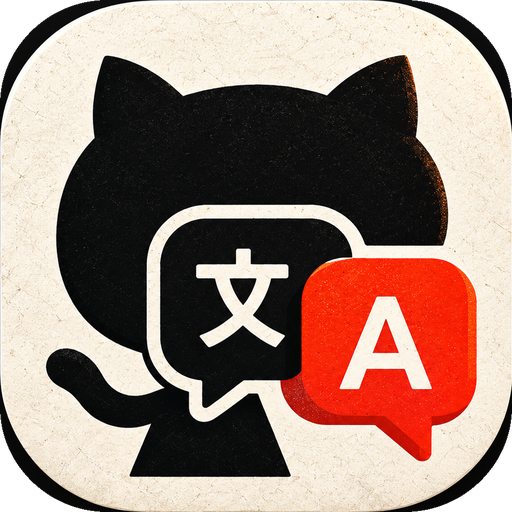

  

<h1 align="center">GitTranslate</h1>

  <b>Read any GitHub README in your own language, right inside the GitHub app.</b> 
  <b>Her GitHub README'sini, GitHub uygulamasından çıkmadan kendi dilinde oku.</b>

  <a href="../../releases/latest">⬇️ Download / İndir</a> ·
  <a href="#english">English</a> ·
  <a href="#türkçe">Türkçe</a>

---

## English

You open a repository in the GitHub app and the README is in Chinese, Japanese, Russian… or English you can't follow. You don't know what the project does, how to install it, or where to start.

**GitTranslate** adds a small 文→A bubble next to the GitHub app. Tap it while you are inside a repository: the README opens in a panel on top of GitHub, **translated into your language**. Close the panel and you are back where you were.

### Features

- **⚡ Ready before you tap.** As soon as you open a repository, GitTranslate fetches the README, the *About* text and the latest release notes and translates them in the background. While it works, the bubble stays grey with a progress ring; when everything is translated it turns colourful, and a tap opens the translated page instantly.
- **📖 README, About and Releases.** The places people look first: the description, topics and website (*About*), the full README, and the latest release with its notes and downloads. Code blocks are not translated, and you can copy them with one tap.
- **🖼️ Readable layout.** Headings, lists, tables, quotes, code and screenshots, cleaned up for a phone screen. Badges and HTML clutter are removed.
- **🧭 "More about this repository".** In plain words: what kind of project it is, whether it runs on a phone or a computer, what the license allows, ready-made downloads (APK/EXE/DMG), and what the important folders are for.
- **🌐 19 languages.** Turkish, English, German, French, Spanish, Portuguese, Italian, Dutch, Polish, Russian, Ukrainian, Arabic, Persian, Hindi, Indonesian, Vietnamese, Japanese, Korean and Chinese. The default is your phone's language.
- **🤝 Share menu too.** GitHub → Share → *Explain repo* works without the bubble.
- **No AI, no account, no API key.** Free and open source (MIT).

### Install

1. Download `GitTranslate.apk` from [Releases](../../releases/latest) and install it.
2. Open GitTranslate → **Turn on the bubble** → enable **GitTranslate** under *Accessibility → Downloaded apps*.
   - Android 13+: if it is greyed out ("Restricted setting"), open **App info** → **⋮** (top right) → **Allow restricted settings**, then try again.
3. Optional but recommended: **Allow running in background**, so aggressive battery savers (Xiaomi, Huawei, Samsung…) don't stop the bubble.
4. Open any repository in the GitHub app and tap the bubble.

**Updates:** when a new version is out, GitTranslate shows an **Update now** button. Updating from inside the app keeps the bubble's permission, so you don't need to set anything up again.

Tips: **drag** the bubble to move it (it snaps to the nearest edge). **Hold** it to see which repository it detected. When the bubble is grey, it hasn't recognized a repository on screen yet, but tapping it still makes it look again.

### Privacy

- The bubble uses Android's accessibility service **only while the GitHub app is in front**, and only to find the repository's name on screen (from the screen text, or if needed from a screenshot of the top of the screen that is read **on the device**). It does nothing in other apps and stores nothing.
- Repository information comes from GitHub's public API (`api.github.com`, `raw.githubusercontent.com`).
- README text is translated with Google Translate over the internet. Without internet, the on-device Google ML Kit translator is used.

### How it works

| File | What it does |
|---|---|
| `BalonServisi.kt` | Accessibility service: shows the bubble while GitHub is open and detects the repository |
| `RepoTespit.kt` | Finds `owner/repo` from on-screen texts, and completes names that are cut off ("…tive-divisions-of-China") |
| `RepoActivity.kt` | The panel: README view and the "more about this repository" view |
| `GitHubApi.kt` | GitHub API client: 2 requests for a README, disk cache, raw-server fallback when the hourly limit is reached |
| `Markdown.kt` | Turns README Markdown/HTML into headings, paragraphs, lists, code, tables and images |
| `RepoAnaliz.kt` | Rule-based hints: project type, license meaning, folder explanations, section types |
| `CeviriMotoru.kt` | Translation: Google Translate first, on-device ML Kit as fallback, with a cache |

`Markdown.kt`, `RepoAnaliz.kt` and `RepoTespit.kt` don't depend on Android and have unit tests in `app/src/test`.

### Building

You don't need a computer. Every push to `main` runs the tests, builds the APK on GitHub Actions and publishes a new release.

**Signing:** every release is signed with the same key, so updates install over the previous version. On the first build, the workflow creates a key and keeps it in the Actions cache. To keep it forever, add your own key as repository secrets `IMZA_DOSYASI_B64` (the keystore, base64) and `IMZA_SIFRE` (its password, alias `gittranslate`).

Contributions are welcome! Adding a language to section detection only takes a few keywords in `RepoAnaliz.kt`.

> GitTranslate is an independent open-source project and is not affiliated with or endorsed by GitHub, Inc.

---

## Türkçe

GitHub uygulamasında bir repoya giriyorsun, README Çince, Japonca, Rusça… ya da anlayamadığın bir İngilizceyle yazılmış. Projenin ne işe yaradığını, nasıl kurulduğunu, nereden başlayacağını bilmiyorsun.

**GitTranslate**, GitHub uygulamasının yanına küçük bir 文→A balonu ekler. Bir reponun içindeyken balona dokun: README, GitHub'ın üstünde açılan bir panelde **senin diline çevrilmiş olarak** görünür. Paneli kapatınca kaldığın yere dönersin.

### Özellikler

- **⚡ Sen dokunmadan hazır.** Bir repoyu açar açmaz GitTranslate README'yi, *About* açıklamasını ve son sürüm notlarını arka planda indirip çevirir. Bu sırada balon gri kalır ve çevresinde bir ilerleme halkası dolar; her şey çevrilince balon renklenir, dokununca çevrilmiş sayfa anında açılır.
- **📖 README, Hakkında ve Sürümler.** İnsanların ilk baktığı yerler: açıklama, konular ve web sitesi (*About*), README'nin tamamı ve son sürümün notları ile indirmeleri. Kod blokları çevrilmez, tek dokunuşla kopyalanır.
- **🖼️ Okunaklı düzen.** Başlıklar, listeler, tablolar, alıntılar, kodlar ve ekran görüntüleri telefon ekranına göre sadeleştirilir. Rozetler ve HTML kalabalığı temizlenir.
- **🧭 "Bu repo hakkında daha fazla".** Sade bir dille: ne tür bir proje, telefonda mı bilgisayarda mı kullanılır, lisans neye izin veriyor, hazır indirmeler (APK/EXE/DMG), önemli klasörler ne işe yarıyor.
- **🌐 19 dil.** Türkçe, İngilizce, Almanca, Fransızca, İspanyolca, Portekizce, İtalyanca, Felemenkçe, Lehçe, Rusça, Ukraynaca, Arapça, Farsça, Hintçe, Endonezce, Vietnamca, Japonca, Korece ve Çince. Varsayılanı telefonunun dilidir.
- **🤝 Paylaş menüsü de var.** Balonu kullanmadan GitHub → Paylaş → *Repoyu anlat* ile de açılır.
- **Yapay zekâ yok, hesap yok, API anahtarı yok.** Ücretsiz ve açık kaynak (MIT).

### Kurulum

1. [Releases](../../releases/latest) bölümünden `GitTranslate.apk` dosyasını indirip kur.
2. GitTranslate'i aç → **Balonu aç** → *Erişilebilirlik → İndirilen uygulamalar* altında **GitTranslate**'i aç.
   - Android 13 ve üstü: gri görünüyor ya da "Kısıtlı ayar" diyorsa **Uygulama bilgisi** → sağ üstteki **⋮** → **Kısıtlanmış ayarlara izin ver**, sonra tekrar dene.
3. İsteğe bağlı ama önerilir: **Arka planda çalışmasına izin ver**. Böylece agresif pil tasarrufu yapan telefonlar (Xiaomi, Huawei, Samsung…) balonu kapatmaz.
4. GitHub uygulamasında herhangi bir repoyu aç ve balona dokun.

**Güncellemeler:** Yeni sürüm çıkınca GitTranslate'te **Şimdi güncelle** düğmesi belirir. Uygulamanın içinden güncellersen balonun izni korunur, bir şeyi yeniden ayarlaman gerekmez.

İpuçları: balonu **sürükleyerek** taşıyabilirsin, bırakınca en yakın kenara yapışır. **Basılı tutarsan** hangi repoyu bulduğunu gösterir. Balon griyse ekranda henüz bir repo tanımamıştır; yine de dokunursan tekrar arar.

### Gizlilik

- Balon, Android'in erişilebilirlik servisini **yalnızca GitHub uygulaması öndeyken** ve sadece ekrandaki repo adını bulmak için kullanır. Adı ekran yazısından, gerekirse ekranın üst kısmının görüntüsünden bulur ve bu görüntü **telefonun içinde** okunur. Başka uygulamalarda hiçbir şey yapmaz, hiçbir şey saklamaz.
- Repo bilgileri GitHub'ın herkese açık API'sinden gelir (`api.github.com`, `raw.githubusercontent.com`).
- README metni internet üzerinden Google Çeviri ile çevrilir. İnternet yoksa telefonun içindeki Google ML Kit çevirmeni kullanılır.

### Derleme

Bilgisayar gerekmez. `main` dalına her gönderimde GitHub Actions testleri çalıştırır, APK'yı derler ve yeni bir sürüm yayınlar.

**İmza:** Bütün sürümler aynı anahtarla imzalanır, böylece güncellemeler eskisinin üstüne kurulur. İlk derlemede iş akışı bir anahtar üretip Actions önbelleğinde saklar. Anahtarın kalıcı olmasını istersen kendi anahtarını repo secret'ı olarak ekle: `IMZA_DOSYASI_B64` (keystore, base64) ve `IMZA_SIFRE` (şifresi; takma ad `gittranslate`).

Katkılara açığız! Bölüm tanımaya yeni bir dil eklemek için `RepoAnaliz.kt` içindeki listelere birkaç anahtar kelime eklemek yeterli.

> GitTranslate bağımsız bir açık kaynak projesidir; GitHub, Inc. ile bir bağlantısı yoktur ve GitHub tarafından onaylanmamıştır.
